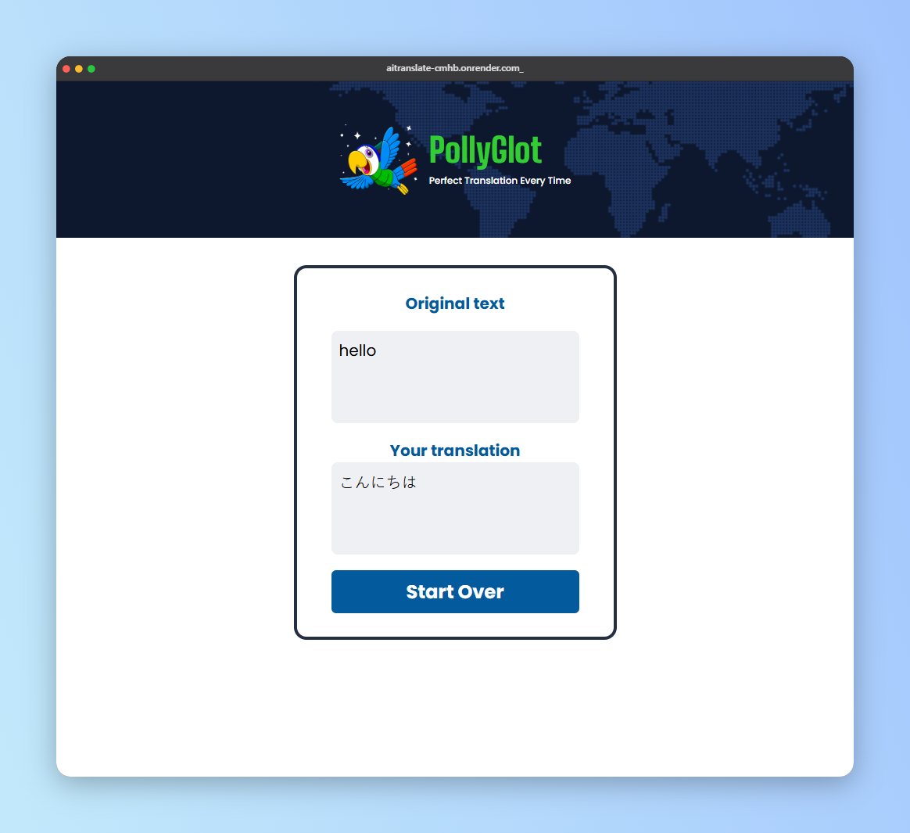

# PollyGlot (AITranslate)

An AI-powered translator web app. Type a text, pick a language, and get a natural, native-sounding translation in seconds.

**Live demo:** https://aitranslate-cmhb.onrender.com

> The app runs on a free Render instance, so the first visit after a period of inactivity can take up to a minute while the server wakes up.



## Features

- Translate text into **French**, **Spanish**, or **Japanese** with radio buttons
- Source language is detected automatically
- Translations aim to sound the way a native speaker would say them, not word for word
- Result screen shows the original text and the translation side by side, with a **Start Over** button
- Input validation and friendly error messages (empty text, server or API errors)
- The AI API key stays on the server and is never exposed to the browser

## Tech stack

- **Frontend:** HTML, CSS, vanilla JavaScript, built with [Vite](https://vite.dev/)
- **Backend:** Node.js with [Express](https://expressjs.com/)
- **AI:** Google Gemini, called through the OpenAI SDK's OpenAI-compatible endpoint
- **Hosting:** [Render](https://render.com/) (free web service)

## How it works

```
Browser  ──POST /api/translate──▶  Express server  ──▶  Gemini API
(index.js)   { text, lang }        (server.js)          (key lives here)
         ◀──── { translation } ────
```

1. The browser sends the text and the selected language to `/api/translate`.
2. The Express server validates the request, builds the prompt, and calls the AI API with the secret key.
3. The server returns only the translation, and the frontend shows it on the result screen.

### Security and abuse protection

- The API key is read from environment variables on the server only, so it never appears in the browser bundle or network requests.
- The server only accepts the supported languages and limits the text to 1,000 characters.
- Rate limiting allows 10 requests per minute per IP address.
- The system prompt treats everything inside `<text>` tags as content to translate, never as instructions, which helps against prompt injection.
- Translations are inserted into the page as plain text, never as HTML.

## Getting started

### Prerequisites

- [Node.js](https://nodejs.org/) v24.22.0
- An API key from [Google AI Studio](https://aistudio.google.com/)

### Installation

```bash
git clone https://github.com/ziadmohamed1911/AITranslate.git
cd AITranslate
npm install
```

### Environment variables

Create a `.env` file in the project root:

```
AI_KEY=your_api_key_here
AI_URL=https://generativelanguage.googleapis.com/v1beta/openai/
AI_MODEL=your_model_id
```

| Variable | Description |
|---|---|
| `AI_KEY` | Your API key |
| `AI_URL` | Base URL of the OpenAI-compatible endpoint |
| `AI_MODEL` | Model ID to use (check your provider's docs for current names) |

`.env` is listed in `.gitignore` and must never be committed.

### Run locally

Use two terminals:

```bash
# Terminal 1: Express server on port 3000
node server.js

# Terminal 2: Vite dev server on port 5173
npm run dev
```

Open http://localhost:5173. Vite proxies `/api` requests to the Express server (see `vite.config.js`).

### Production build

```bash
npm run build
npm start
```

This builds the frontend into `dist/`, and Express serves it together with the API on one port.

## Project structure

```
AITranslate/
├── assets/          # images
├── index.html       # page markup
├── index.js         # frontend logic (browser)
├── style.css        # styles
├── server.js        # Express server and AI call (Node)
├── vite.config.js   # dev proxy for /api
└── package.json
```

## Deployment

The app is deployed as a single **Render** web service:

| Setting | Value |
|---|---|
| Build command | `npm install --include=dev && npm run build` |
| Start command | `npm start` |
| Environment variables | `AI_KEY`, `AI_URL`, `AI_MODEL` |

Every push to `main` triggers a new deploy.

## What I learned

- Why API keys must not live in frontend code, and how to move the AI call to a server
- Setting up an Express API with validation and rate limiting
- Using environment variables locally and in production
- Proxying API requests in Vite during development
- Writing prompts that keep a model's output clean and resistant to prompt injection
- Debugging CORS, 404, and 400 errors from the browser and server logs

## Future improvements

- Add more languages
- Add a copy-to-clipboard button for the translation
- Add text-to-speech for the translated text
- Remember the last selected language

## Author

**Ziad Mohamed**
GitHub: [@ziadmohamed1911](https://github.com/ziadmohamed1911)
